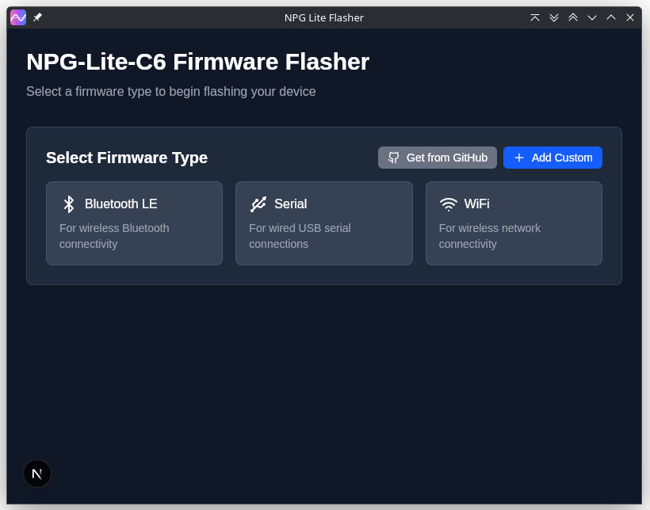

# NPG-Lite-Flasher
Flashing app for NPG Lite. It flashes the same way as Arduino IDE, using esptool.

## Installation Instructions
### Windows  
If you see a warning saying "Microsoft Defender SmartScreen prevented an unrecognized app from starting. Running this app might put your PC at risk," it is likely due to Windows blocking unsigned apps. To bypass this:

1. Click **More Info** on the warning screen.
2. Click **Run Anyway** to continue and install the app.

This will allow the app to run without issues.

## Build instructions

1. `npm i`
2. `npm run fetch-esptool` (downloads esptool 5.3.1 into src-tauri/binaries, needed before every build on a new machine)
3. `npx tauri build`